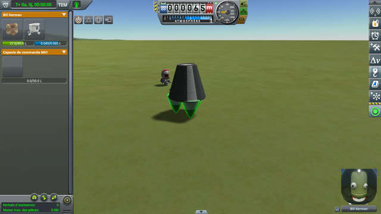
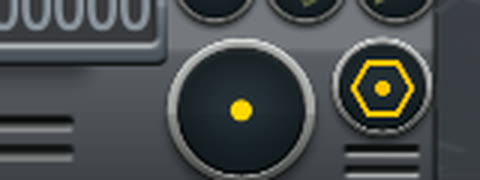
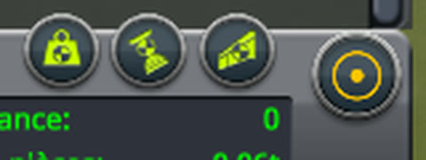
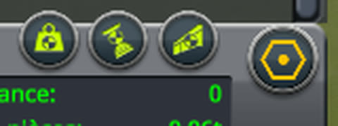
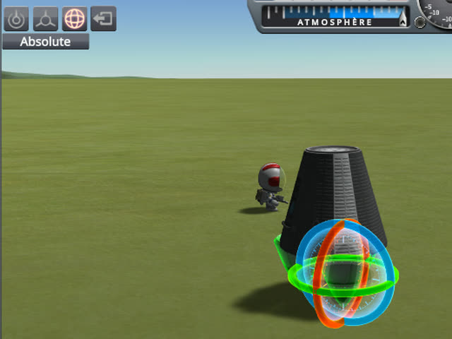
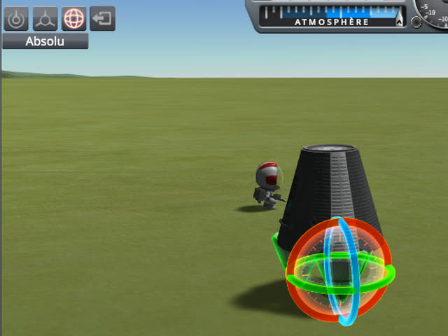
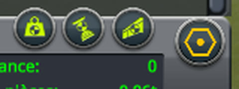
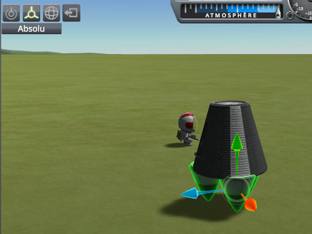
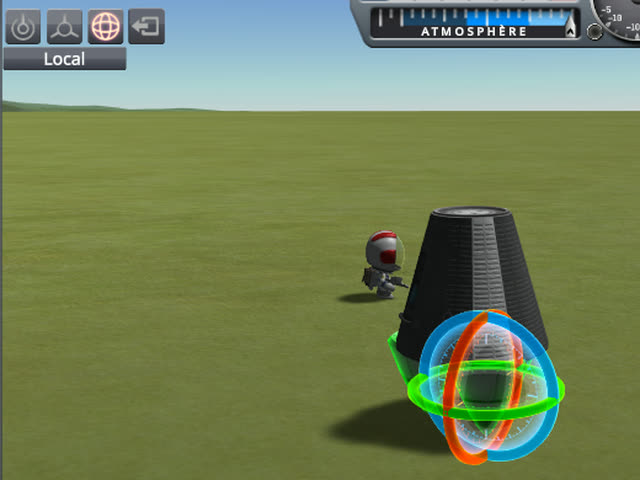
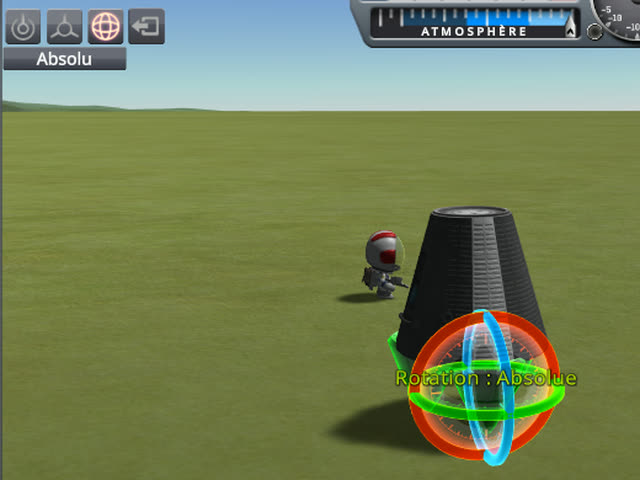

# Construction Buttons Fix

**⚠️ Not finished yet.** This is a new fix, not a finished mod. The code and the conclusions on this page can still change.

A fix for stock KSP 1.12, kept as small as possible: four Harmony postfixes, in two source files. It is a mod of its
own, built on top of [KSP Community Fixes](https://github.com/KSPModdingLibs/KSPCommunityFixes), the base most
players run. Here is what it fixes:

> **In EVA construction mode, two buttons do not show the mode in use.** The snap button shows fine moves when the
> mode opens, and again after every pause, while parts move and turn by steps. The coordinate space button reads
> *Absolute*, in English whatever the language of the game, until its first click, even when the Rotate tool turns
> the part in local space.

**How this was made.** The investigation and the code were written with Claude, Anthropic's AI
assistant. Everything here was reviewed and validated by a human — me. I am saying so up front, because
contributions made with an AI deserve a closer look than others, and because some people would rather
stop reading here. That look should be quick: the stock code involved is named and quoted on this page, every check
below is read on screenshots of the game, and the fix is two short source files you can read in a few minutes.

## Why it matters

In EVA construction mode, an engineer moves and turns the parts of a vessel with the same tools as the editor's.
Two buttons choose how: the snap button, at the bottom left of the construction panel, switches between fine moves
(a circle) and moves by steps (a hexagon); the coordinate space button, under the tools at the top left, switches the
gizmo between the axes of the part (*Local*) and the axes of the world (*Absolute*). Both settle where a part ends
up, and the player reads them before dragging the gizmo.



### The snap button

The snap setting is shared with the editor. In the Vehicle Assembly Building, its button shows the hexagon: moves by
steps, the default.



In EVA construction mode, the same setting shows the circle. A first click on the button switches to fine moves,
and the circle stays; a second click switches back to steps, and only then does the hexagon show. After a pause,
the circle is back, while parts still move by steps.

| | Snap button |
|---|---|
| Construction mode opened |  |
| First click |  |
| Second click |  |
| Paused, then resumed |  |

### The coordinate space button

The button only shows with a part selected in the Move or Rotate tool. With the Move tool, it reads *Absolute*,
in English in a French game, and the arrows of the gizmo follow the world's axes:


With the Rotate tool, it still reads *Absolute*, but the rings of the gizmo follow the nose cone, turned by 45°
about its own axis. A click on the button switches the gizmo to the world's axes: the rings turn, and the label
reads *Absolu*. A second click switches back: the rings turn back to where they were before the first click, the
label reads *Local*, and the game confirms *Rotation : Locale*.






*KSP 1.12.5 without this mod, with [KSP Community Fixes](https://github.com/KSPModdingLibs/KSPCommunityFixes)
1.41.1, in French, in a 1280 × 720 window, interface at 100 %, west of the space centre, KSP started fresh. The
Vehicle Assembly Building opened from the space centre, then left, and the save below loaded. The construction mode
opened with the Place tool, then the snap button clicked twice, the game paused and resumed. Then the
Move tool picked and the nose cone turned by 45° clicked, the Rotate tool picked, and the coordinate space button
clicked twice. The close-ups of the snap button are cropped from the bottom left of the screen and zoomed three
times; the views of the coordinate space button are cropped from the top left of the screen, gizmo included.*

To play it yourself, copy [construction-buttons.sfs](diag/construction-buttons.sfs) into the folder of a sandbox game
and load it: Bill, an engineer, is on EVA five metres from a Mk1 pod standing on three small nose cones, the one
facing the camera turned by 45° about its own axis. Start KSP again before each try: the coordinate space of the
gizmos is kept from one part to the next, and from one flight to the next, until KSP quits.

## The culprits

### The snap icon is never set from the setting

The editor sets the snap icon from the setting when it starts:

```csharp
// EditorLogic.Start (KSP 1.12)
angleSnapSprite.SetState(GameSettings.VAB_USE_ANGLE_SNAP ? 1 : 0);
```

`EVAConstructionModeEditor` only does it in `SnapButton`, after flipping the setting. Until then, the icon, a
`UIStateImage`, keeps the start state of its prefab, `None`: the circle. `GameSettings.VAB_USE_ANGLE_SNAP` is true by
default, so the icon shows fine moves while parts move by steps. The first click flips the setting to fine and sets
the circle again: no change on screen.

### A pause sets every state image to the time warp rate

```csharp
// UIStateImage.onGameUnPause (KSP 1.12)
SetState(TimeWarp.CurrentRateIndex);
```

Every `UIStateImage` listens to the end of a pause and takes the state of the index of the time warp rate, which
suits the time warp buttons it was written for. The snap icon is one too: out of time warp, index 0, the circle,
whatever the setting.

### The coordinate space label is never set before the first click

The editor writes the label of the button when it enters its offset and rotate states, from the gizmo's coordinate
space. `EVAConstructionModeEditor` only writes it in `ChangeCoordSpace`, the button's click: `#autoLOC_6001217`
(*Absolute*) for `Space.World`, `#autoLOC_6001218` (*Local*) for `Space.Self`. Until the first click, the label is
the prefab's text, *Absolute*, never translated.

The coordinate spaces of the gizmos are static fields: `GizmoOffset.coordSpace` starts at `Space.World`, and
`GizmoRotate.coordSpace` at `Space.Self`. So the prefab's *Absolute* is the Move tool's space, and the opposite of
the Rotate tool's.

## The fixes

Two fixes, each with its switch in [Settings](#settings), both on by default. Nothing is saved; removing the mod gives
the stock behaviour back at once.

- **`snapIcon`.** When the construction mode opens (`EVAConstructionModeEditor.OnConstructionMode`), and at the end
  of a pause (`UIStateImage.onGameUnPause`, for the snap icon only), the icon is set from the setting, with the same
  states as `SnapButton`. The other state images, the time warp buttons among them, are left as on stock.
- **`coordSpaceLabel`.** Each time the Rotate or Move gizmo is asked for (`EVAConstructionModeEditor.ToggleRotateGizmo`
  and `ToggleOffsetGizmo`), the label is written from that gizmo's coordinate space, with the same translated strings
  as `ChangeCoordSpace`.

A stock method or field that is missing leaves its fix out, with an error in `KSP.log`; the other fix is still
installed.

**Why not read the space from the gizmo the construction mode holds.** When the tool changes, the gizmo of the tool
left is detached in the same frame as the new one is attached, and a detached gizmo is only destroyed at the end of
the frame: until then, the construction mode still holds both. The static space of each kind of gizmo is the one its
next gizmo will use.

**Why not patch `ToggleCoordSpaceButton`, which shows the button.** On a change of tool, it is called before the
construction mode records the new tool: the tool it would read is the one being left.

## Checked: the snap button

KSP 1.12.5 in French with KSP Community Fixes 1.41.1, the save above loaded, the construction mode opened with the
Place tool, then the game paused and resumed, as in [Why it matters](#why-it-matters).

- **Without the mod:** the circle when the mode opens, and again after the pause, as shown above.
- **With the mod:** the hexagon when the mode opens, and still after the pause. Clicks on the button switch the icon
  at each click, and a pause after a click keeps the icon of the setting.

| | With this mod |
|---|---|
| Construction mode opened |  |
| Paused, then resumed |  |

## Checked: the coordinate space button

The same game, KSP started fresh, the turned nose cone selected with the Move tool, then the Rotate tool picked and
the button clicked.

- **Without the mod:** *Absolute* with both tools, as shown above.
- **With the mod:** *Absolu* with the Move tool, *Local* with the Rotate tool, the rings tilted with the cone; a
  click reads *Absolu*, the rings turned to the world's axes. Back to the Move tool, the label reads the Move tool's
  own space again, and each tool keeps its own space from then on.







At `Debug`, the mod writes one line each time it sets a button; for the gestures above, after its startup lines:

```
[KSPFixConstructionButtons] Version 0.1.0.0, snapIcon True, coordSpaceLabel True, log level Debug
[KSPFixConstructionButtons] Snap icon fix installed
[KSPFixConstructionButtons] Coordinate space label fix installed
[KSPFixConstructionButtons] [DEBUG] Snap icon set to snapped (construction mode opened)
[KSPFixConstructionButtons] [DEBUG] Snap icon set to snapped (game unpaused)
[KSPFixConstructionButtons] [DEBUG] Coordinate space button set to World (move gizmo)
[KSPFixConstructionButtons] [DEBUG] Coordinate space button set to Self (rotate gizmo)
```

## Work in progress

What a player would see if this mod broke something, or what it should fix but was not checked yet, and how to try
it by hand, with the mod and without:

- **A part that can be neither moved nor turned.** The button still shows, with no gizmo; its label is left as it
  was, and a click does nothing, as on stock. Select such a part with the Move tool, then the Rotate tool.
- **The time warp buttons after a pause.** They should still show the time warp rate. Pause and resume during time
  warp, the construction mode open and closed.
- **The snap setting changed elsewhere in flight.** The `Editor_toggleAngleSnap` key goes through `SnapButton`, which
  sets the icon itself; a mod that changes `GameSettings.VAB_USE_ANGLE_SNAP` directly would leave the icon behind
  until the next opening of the construction mode or the next pause.

## Install

Copy the `GameData\KSPFixConstructionButtons` folder into the `GameData` folder of KSP. It needs
[Harmony](https://github.com/KSPModdingLibs/HarmonyKSP), as KSP Community Fixes does.

## Settings

`GameData\KSPFixConstructionButtons\PluginData\settings.cfg` is read once, when KSP starts:

```
// Makes the snap button of the EVA construction mode show the step actually in use.
snapIcon = True

// Makes the coordinate space button of the EVA construction mode read, translated, the space the move or rotate
// gizmo actually uses.
coordSpaceLabel = True

// How much the mod writes to KSP.log: Error, Warning, Info or Debug.
logLevel = Info
```

- With `snapIcon = False`, the snap icon shows the circle when the mode opens and after each pause, as on stock.
- With `coordSpaceLabel = False`, the coordinate space button reads *Absolute* until its first click, as on stock.
- At `Debug`, the mod writes one line each time it sets a button.

## Build

Set `KSPDIR` to the folder of a KSP install with Harmony in its `GameData`, then run `build.bat`: it
compiles `GameData\KSPFixConstructionButtons\KSPFixConstructionButtons.dll`. Installing is up to you.

## License

[MIT](LICENSE).
